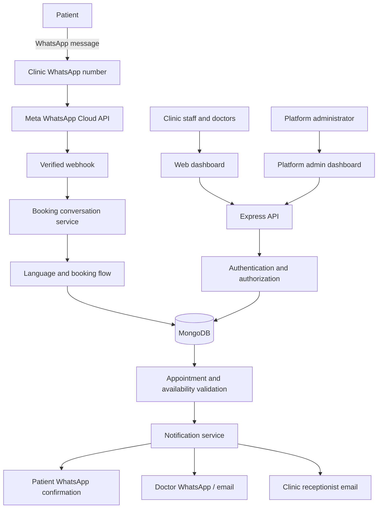

# Healthcare Submission

A multi-clinic appointment booking platform designed to help patients
find services, choose doctors, and request appointments through
WhatsApp, while giving healthcare teams secure tools to manage
appointments.

> **Project status:** Early development / MVP in progress. The backend
> foundation, initial MongoDB models, email OTP utilities,
> authentication routes, MongoDB-backed session configuration, and
> initial authentication/RBAC middleware are implemented. The
> dashboards, WhatsApp booking flow, clinic-level authorization, and
> production security hardening are not complete.

## Why this project?

Many clinics coordinate appointments manually through calls and
messages. Healthcare Submission aims to make appointment booking more
consistent and accessible while keeping each clinic's operational data
separated.

## How it is intended to work

1.  A patient messages a clinic's WhatsApp number.
2.  The chatbot welcomes the patient and offers English, Nepali, Hindi,
    or Bhojpuri.
3.  The patient chooses a healthcare service, doctor, date, and
    available time.
4.  The patient completes the registration fields configured for that
    doctor.
5.  The patient reviews the details and confirms the booking.
6.  The platform validates availability and reserves the appointment.
7.  The patient and relevant clinic staff receive notifications.

The chatbot is for appointment coordination only. It will not diagnose
conditions, recommend treatment, or prescribe medication. Emergency
messages need a carefully reviewed escalation response.

## Prototype preview

The following image is a **conceptual UI mockup**, not a screenshot of a
working application. It illustrates the intended patient WhatsApp
booking journey and a clinic dashboard. Names, appointment rows, and
other sample details are placeholders.


## Planned system overview

The diagram describes the intended architecture. Some integrations and
workflows are still under development.



## Main capabilities

### Patient booking --- planned

-   WhatsApp booking through each clinic's own number.
-   English, Nepali, Hindi, and Bhojpuri language selection.
-   Service, doctor, date, and time selection.
-   Doctor-specific registration forms.
-   Booking review, confirmation, and notifications.

### Clinic and platform management --- planned

-   Central platform administrator registers clinics and doctors.
-   Separate clinic dashboards.
-   Clinic-specific doctors, services, availability, forms, and
    appointments.
-   Role-based access for `platform_admin`, `clinic_admin`,
    `receptionist`, and `doctor`.

### Authentication foundation --- in progress

-   Email and password login.
-   Password hashing with bcrypt.
-   Email OTP verification.
-   Hashed OTP storage, expiration, and attempt limits.
-   MongoDB-backed server-side sessions.
-   HTTP-only session cookies.
-   Initial authentication and role middleware.

## Technology stack

  Area                    Technology
  ----------------------- ------------------------------------
  Frontend                React, Vite, Tailwind CSS
  Backend                 Node.js, Express
  Database                MongoDB Atlas, Mongoose
  Authentication          bcrypt, email OTP, express-session
  Session storage         MongoDB with connect-mongo
  Email                   Nodemailer and SMTP
  WhatsApp                Meta WhatsApp Cloud API (planned)
  API testing             Postman
  Local webhook testing   ngrok
  Version control         Git and GitHub

## Advantages

-   **Convenient patient access:** Patients can start booking through a
    familiar messaging app without a dashboard account.
-   **Clinic-specific communication:** Each clinic can use its own
    WhatsApp number.
-   **Multilingual experience:** Language selection can make booking
    more accessible.
-   **Central administration:** Platform administrators can manage
    clinic onboarding.
-   **Role separation:** Staff and doctors receive access appropriate to
    their responsibilities.
-   **Extensible design:** Separate services, models, and integrations
    support future growth.

## Disadvantages and challenges

-   **External provider dependency:** WhatsApp delivery, templates,
    pricing, and account approval depend on Meta.
-   **Operational complexity:** Multi-clinic onboarding and phone-number
    configuration require careful administration.
-   **Security responsibility:** Patient and appointment information
    require strict access controls and legal compliance.
-   **Booking concurrency:** Simultaneous requests must not double-book
    a doctor or time slot.
-   **Email delivery limitations:** SMTP providers can impose limits or
    delay messages.
-   **Ongoing costs:** Hosting, database capacity, WhatsApp
    conversations, email, backups, and monitoring may cost money.

## Security and privacy

Security is a core design requirement, not a final add-on.

-   Store passwords as bcrypt hashes; never store plaintext passwords.
-   Store OTP hashes, not raw OTPs. Enforce expiry, one-time use, and
    attempt limits.
-   Use server-side sessions and HTTP-only cookies. Configure `Secure`,
    `SameSite`, session expiration, and CSRF protection for the deployed
    environment.
-   Enforce authorization on the server for every protected operation.
-   Scope clinic-owned database queries using the authenticated user's
    clinic membership. Never trust a clinic ID supplied by the browser
    as proof of access.
-   Verify that doctors, services, forms, and appointments belong to the
    same clinic before linking or modifying them.
-   Verify Meta webhook signatures and identify the clinic using the
    receiving registered WhatsApp phone-number ID.
-   Keep secrets in environment variables or a managed secret store.
    Never commit `.env`, passwords, API tokens, OTPs, or SMTP
    credentials.
-   Avoid logging patient data, passwords, OTPs, access tokens, or other
    sensitive information.
-   Validate and limit request data; use secure headers, rate limits,
    and safe error responses.
-   Add backups, monitoring, audit trails, dependency updates, and
    security testing before production.
-   Collect only information needed for appointment coordination and
    provide clear privacy information.
-   Do not use the chatbot to diagnose, prescribe, or replace
    professional medical care.

> **Important:** This is a development foundation, not a
> production-certified healthcare system. Before handling real patient
> information, complete a security review, tenant-isolation and
> authorization tests, CSRF and cookie configuration,
> booking-concurrency protection, webhook verification, backups,
> monitoring, and applicable privacy/legal reviews.

## Repository structure

``` text
healthcare-submission/
├── backend/
│   ├── src/
│   │   ├── config/
│   │   ├── models/
│   │   ├── controllers/
│   │   ├── routes/
│   │   ├── services/
│   │   ├── middleware/
│   │   ├── bot/
│   │   ├── utils/
│   │   ├── app.js
│   │   └── server.js
│   ├── tests/
│   ├── .env.example
│   └── package.json
├── frontend/
├── docs/
├── .gitignore
└── README.md
```

## Local development

### Prerequisites

-   Node.js (supported LTS release)
-   npm
-   MongoDB Atlas or a local MongoDB instance
-   Git

### Backend setup

``` bash
cd backend
npm install
```

Create `backend/.env` using `backend/.env.example` as a reference.
Configure your own credentials locally; never commit `.env`.

Typical environment variables:

``` env
NODE_ENV=development
PORT=5000
CLIENT_URL=http://localhost:5173
MONGODB_URI=your_mongodb_connection_string

LOGIN_OTP_SECRET=your_unique_random_secret
SESSION_SECRET=your_different_unique_random_secret

SMTP_HOST=smtp.gmail.com
SMTP_PORT=587
SMTP_USER=your_sender_email
SMTP_PASS=your_email_provider_app_password
EMAIL_FROM=your_sender_email
EMAIL_FROM_NAME=Healthcare Submission
```

Generate unique random secrets. Never paste real credentials into this
README, issues, or chat.

Start the backend:

``` bash
npm run dev
```

Health endpoint: `GET http://localhost:5000/api/health`

## Current authentication endpoints

These backend routes have been added but still require end-to-end
security testing before real use.

  -----------------------------------------------------------------------
  Method                Endpoint                  Purpose
  --------------------- ------------------------- -----------------------
  POST                  `/api/auth/request-otp`   Verify credentials and
                                                  request an email OTP

  POST                  `/api/auth/verify-otp`    Verify OTP and
                                                  establish a server-side
                                                  session

  POST                  `/api/auth/logout`        Destroy the current
                                                  session
  -----------------------------------------------------------------------

The frontend is not yet complete. Use test accounts and non-production
data during development.

## Development roadmap

-   [x] Initial backend structure and environment configuration
-   [x] MongoDB connection and initial data models
-   [x] Password hashing utility
-   [x] OTP generation and hashing utilities
-   [x] Email service and OTP email template
-   [x] Initial authentication and OTP verification services
-   [x] Authentication routes and rate-limiting middleware
-   [x] MongoDB-backed session configuration
-   [x] Initial authentication and role middleware
-   [ ] Complete and test clinic-level tenant authorization
-   [ ] Add CSRF protection and complete session security
-   [ ] Add automated authentication and authorization tests
-   [ ] Build clinic and platform administrator dashboards
-   [ ] Build doctor and receptionist workflows
-   [ ] Implement WhatsApp webhook verification and conversation
    handling
-   [ ] Implement multilingual booking
-   [ ] Implement safe appointment availability and concurrency handling
-   [ ] Add notification workflows and delivery-failure handling
-   [ ] Complete deployment, monitoring, backup, and security reviews

## Contributing

This project is under active development. Contributions, issue reports,
and constructive feedback are welcome.

Before opening a pull request: 1. Check existing issues and avoid
duplicating work. 2. Explain the problem and proposed change. 3. Add or
update tests where applicable. 4. Run relevant checks locally. 5. Never
include credentials, patient data, or secrets in commits.

## License

A license has not yet been selected. Until a license is added to the
repository, do not assume that the code is available for unrestricted
reuse or redistribution.
